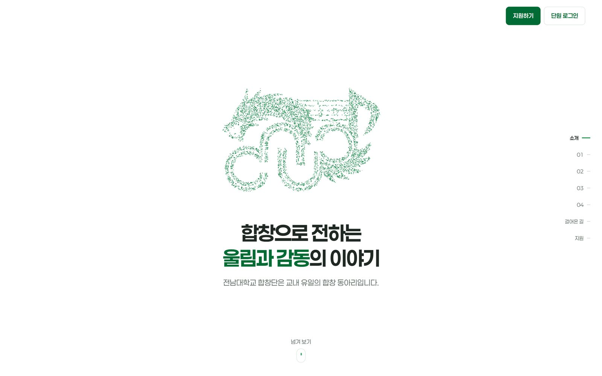
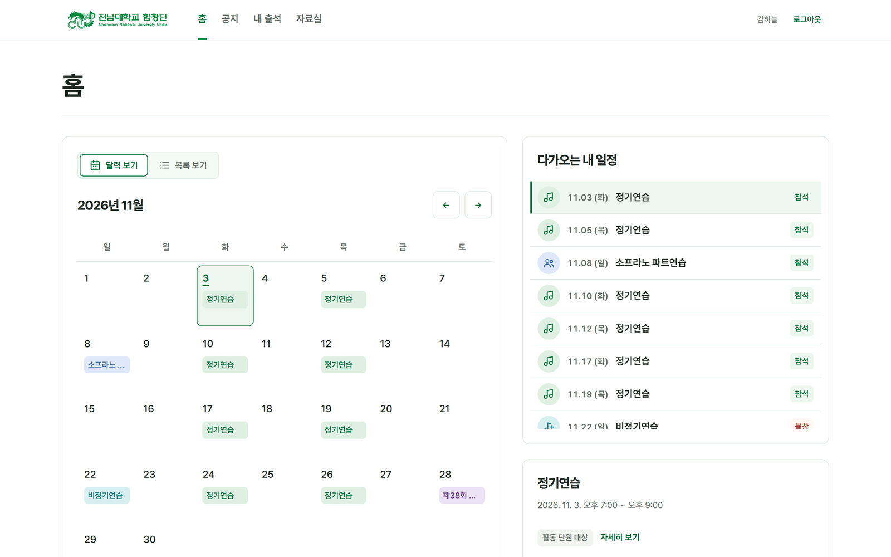
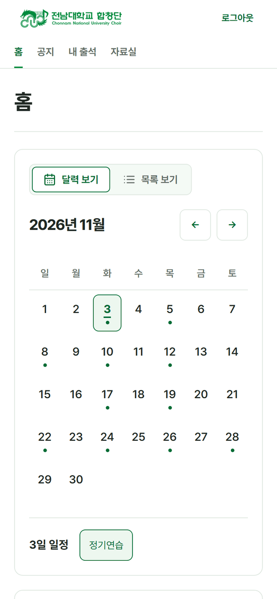
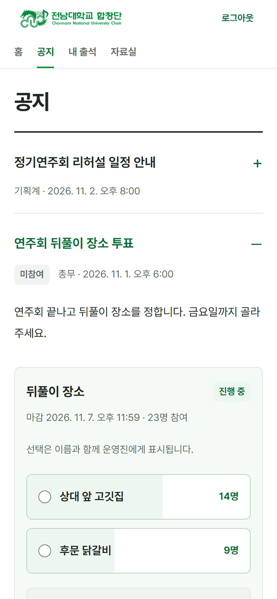
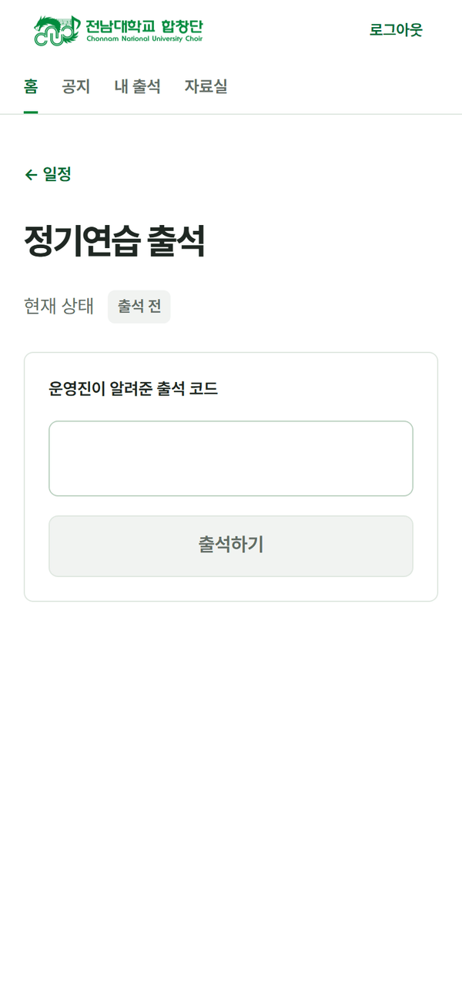
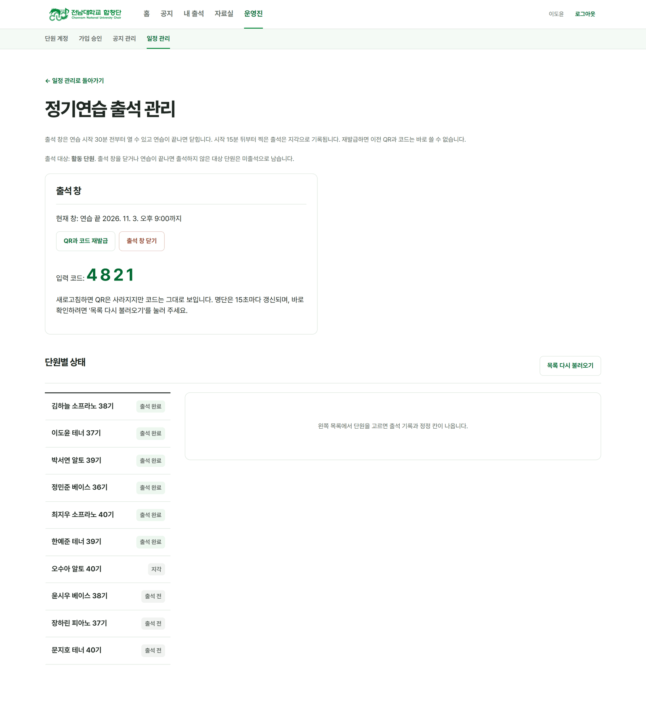

# 전남대학교 합창단 포털



> 연습 일정, 공지, 출석을 한곳에 모은 전남대학교 합창단의 단원 포털

전남대학교 합창단은 교내 유일의 합창 동아리입니다. 이 포털은 합창단을 소개하는 공개 페이지와, 승인된 단원만 들어오는 회원 공간으로 이루어져 있습니다. 단원은 이번 달 연습이 언제인지 보고 참석 여부를 미리 알리고 연습 당일 현장에서 출석을 찍습니다. 운영진은 일정과 공지를 올리고 출석을 받습니다.

운영 주소: [cnuchoir.com](https://cnuchoir.com)

## 왜 만들었나

합창단 운영진은 학업과 연습을 같이 하는 단원들입니다. 그동안 연습 일정은 공유 시트에, 공지는 단체 채팅에, 출석은 현장에서 따로 적어 왔습니다. 이 세 가지를 매주 맞춰 두는 일이 운영진의 시간을 꽤 잡아먹었고 단원도 이번 달 연습이 몇 번인지, 이번 주에 누가 오는지, 지난달 내 출석이 어땠는지 알려면 세 군데를 뒤져야 했습니다.

### 일정이 채팅에 묻힘

단체 채팅에 올린 일정은 며칠만 지나도 찾기 어렵습니다. 같은 질문이 돌아오면 운영진이 다시 올려야 하고 새로 들어온 단원일수록 어디를 봐야 하는지 모릅니다.

### 참석 인원을 손으로 모음

연습마다 누가 오는지 운영진이 한 사람씩 물어 모았습니다. 연주회 전 집중 연습처럼 인원이 중요한 날일수록 손이 많이 갔습니다.

### 출석이 기억에만 남음

현장에서 부른 출석은 나중에 확인할 수 없었습니다. 단원이 그날 왔다고 해도 운영진이 확인할 길이 없고 정정해 주고 싶어도 근거가 없었습니다.

## 어떻게 풀었나

운영진이 손으로 하던 일은 포털이 대신하고 단원은 한 곳만 보면 되게 했습니다.

| 불편 | 포털에서 |
| --- | --- |
| 일정이 채팅에 묻힘 | 홈 달력에 이번 달 연습과 행사가 종류별로 표시되고, 날짜를 누르면 그날 일정이 바로 보임 |
| 참석 인원 손으로 모음 | 단원이 일정마다 참석과 불참을 미리 답하고, 운영진은 인원과 명단을 한 화면에서 확인 |
| 출석이 기억에만 남음 | 운영진이 출석 창을 열면 단원이 4자리 코드나 QR로 직접 출석하고, 지각과 미출석이 자동으로 남음 |

## 누가 쓰나

| 사람 | 할 수 있는 일 |
| --- | --- |
| 가입 신청자 | 구글로 로그인한 뒤 이름, 기수, 파트를 적고 승인을 기다립니다. |
| 활동 단원 | 일정 확인, 참석 응답, 공지와 투표, 현장 출석, 내 출석 기록, 자료실 |
| OB | OB 참여 대상으로 표시된 행사만 보고 응답합니다. |
| 운영진 | 직책이 있는 단원입니다. 일정과 공지 등록, 출석 받기와 정정, 참석 인원 확인 |
| 사이트 관리자 | 단원 계정 승인과 직책 부여를 포함한 모든 기능 |

## 화면

### 홈



이번 달 달력과 다가오는 내 일정이 한 화면에 있습니다. 달력에는 정기연습, 비정기연습, 파트연습, 중요 행사가 종류별로 표시되고 날짜를 누르면 그날 일정과 참석 응답 버튼이 나옵니다. 목록 보기로 바꾸면 이번 달 연습 횟수와 종류별 개수를 셉니다.

### 휴대폰에서

<p align="center">
  
  
  
</p>

단원 화면은 연습실에서 휴대폰으로 보는 경우가 대부분이라 휴대폰 폭을 기준으로 맞췄습니다. 공지에는 두 가지 중 하나를 고르는 투표를 붙일 수 있고 마감 전까지 선택을 바꿀 수 있습니다. 현장 출석은 운영진이 알려 준 4자리 코드를 넣거나 QR을 찍으면 끝납니다.

### 운영진 출석 관리



운영진이 '출석 받기'를 누르면 QR과 4자리 코드가 발급됩니다. 코드가 새어 나가면 재발급하면 되고 이전 코드는 바로 무효가 됩니다. 인원별 상태를 보면서 사정이 있는 단원은 이유를 적고 정정합니다. 누가 언제 무엇을 바꿨는지 감사 기록에 남습니다.

## 흐름

### 단원

```text
구글 계정으로 로그인
  -> 이름, 기수, 파트 적고 승인 대기
  -> 운영진 승인
  -> 홈에서 이번 달 일정 확인
  -> 일정마다 참석 또는 불참 응답
  -> 연습 당일 코드나 QR로 출석
```

비밀번호를 만들지 않습니다. 구글 로그인만 쓰고 운영진이 단원 명단과 대조해 승인합니다. 자동 승인 명단에 이메일이 있으면 첫 로그인에서 바로 승인됩니다.

### 운영진

```text
월을 고르고 여러 날짜를 한 번에 일정으로 등록
  -> 공지 작성, 필요하면 투표 추가
  -> 연습 당일 출석 창 열기
  -> QR과 코드를 현장에 공유
  -> 연습 뒤 인원별 상태 확인과 정정
```

출석 창은 연습 시작 30분 전부터 열 수 있고 연습이 끝나면 닫힙니다. 시작 15분 뒤부터 찍은 출석은 지각으로 기록됩니다.

## 지키는 것

### 단원 정보는 로그인 안에서만

공개 페이지에는 합창단 소개와 사진, 공식 채널만 있습니다. 일정, 공지, 출석, 단원 명단은 승인된 계정으로 로그인해야 보입니다.

### 기록은 바로잡을 수 있게

출석 정정에는 이유가 필요하고 수행자, 시각, 이전 상태, 바뀐 상태가 함께 남습니다. 코드가 유출되면 재발급으로 끊습니다.

### 권한은 직책에서

단장, 부단장, 총무, 부장, 수석처럼 합창단의 직책이 그대로 포털의 권한이 됩니다. 직책을 바꾸면 다시 로그인하지 않아도 바로 반영됩니다.

### 심심한 화면에는 용이 나옵니다

<p align="center">
  
  
  
</p>

로고의 노래하는 초록 용을 마스코트로 다시 그렸습니다. 일정이 없는 날, 없는 주소, 오류 화면처럼 평소와 다른 자리에만 나옵니다.

## 기술

| 영역 | 기술 |
| --- | --- |
| 웹 | Next.js 16, React 19, TypeScript, CSS Modules, Vitest, Playwright |
| API | Spring Boot 4, Java 21, Spring Security, Spring Session JDBC, Flyway |
| 데이터 | PostgreSQL (Supabase) |
| 배포 | Vercel (웹), Render Docker (API), GitHub Actions (DB 깨우기) |
| 로그인 | Google Identity Services |

웹은 같은 출처의 `/api/v1`을 호출하고 Vercel이 이를 Render의 API로 전달합니다. 세션은 DB에 두고 쿠키는 `HttpOnly`, `Secure`, `SameSite=Lax`입니다.

## 구성

| 폴더 | 내용 |
| --- | --- |
| `web/` | Next.js 웹 |
| `api/` | Spring Boot API |
| `deployment/` | 로컬 프록시 구성, 배포 점검 스크립트, 배포 절차 문서 |
| `docs/` | 용어, 운영 절차, 설계 문서 |

## 로컬 실행

웹만 띄울 때:

```bash
cd web
npm install
npm run dev
```

API까지 띄우려면 PostgreSQL이 필요합니다. `compose.yaml`로 DB를 올린 뒤 `.env.example`의 변수를 채워 `api`에서 `gradlew.bat bootRun`을 실행합니다. 실제 비밀값은 저장소에 넣지 않습니다. 프록시를 포함한 전체 구성은 [deployment/README.md](deployment/README.md)를 따릅니다.

## 문서

- 용어와 규칙: [CONTEXT.md](CONTEXT.md)
- 운영 절차: [docs/operations.md](docs/operations.md)
- 디자인 시스템: [docs/design-system.md](docs/design-system.md)
- 배포: [deployment/vercel.md](deployment/vercel.md), [deployment/hosting-options.md](deployment/hosting-options.md)
